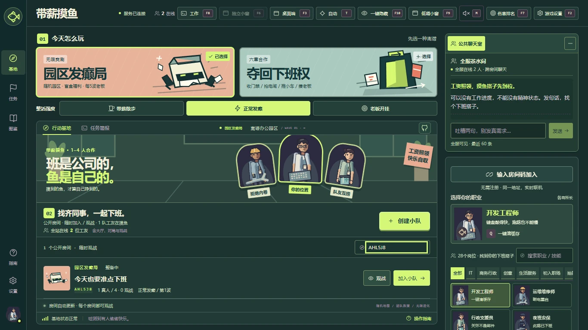
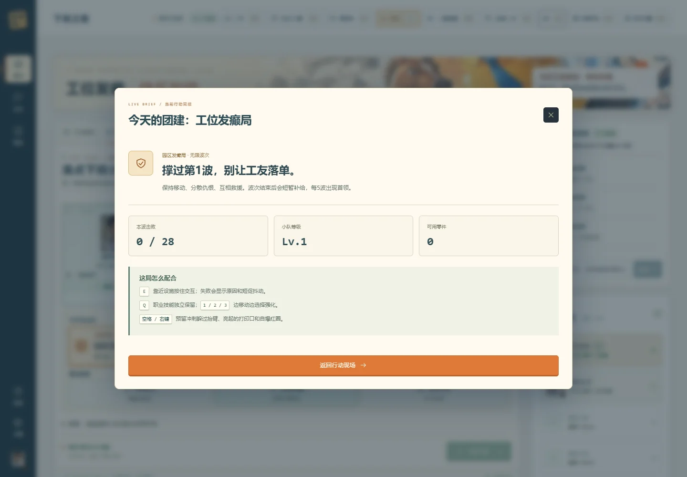
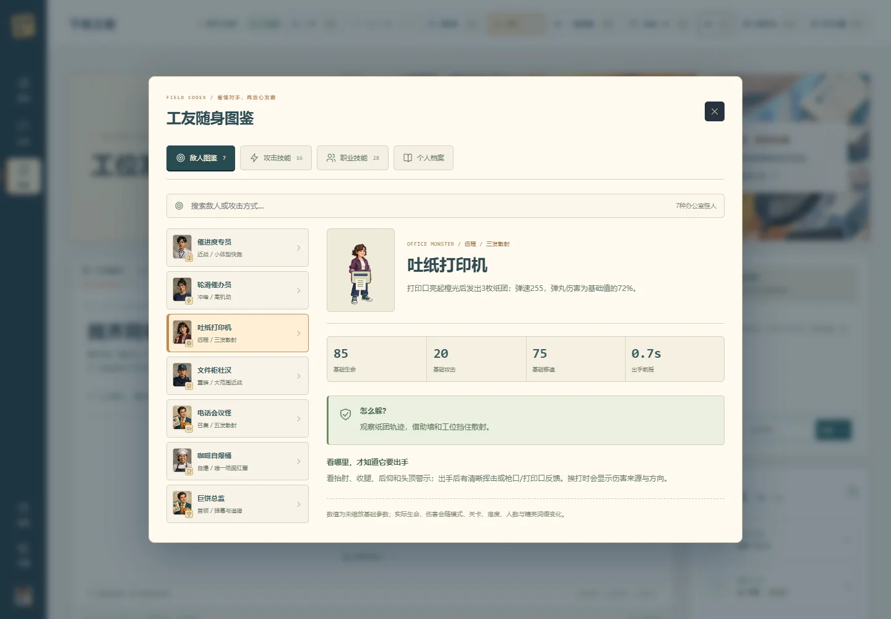
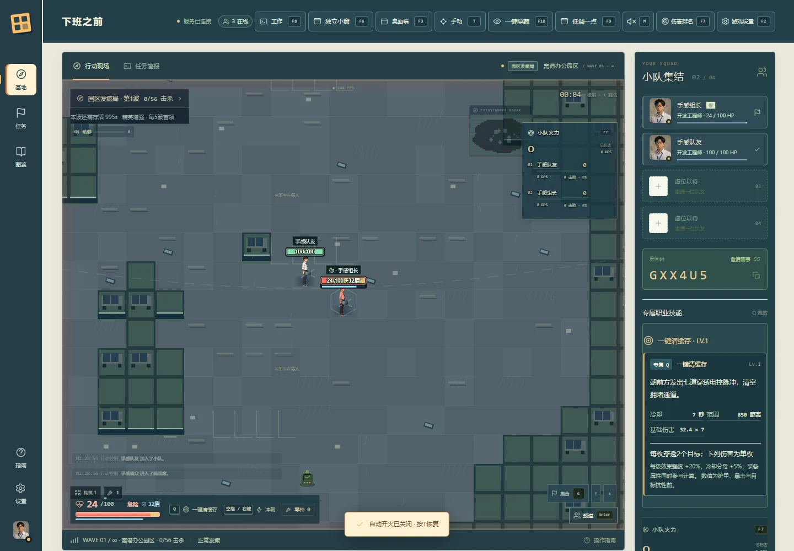
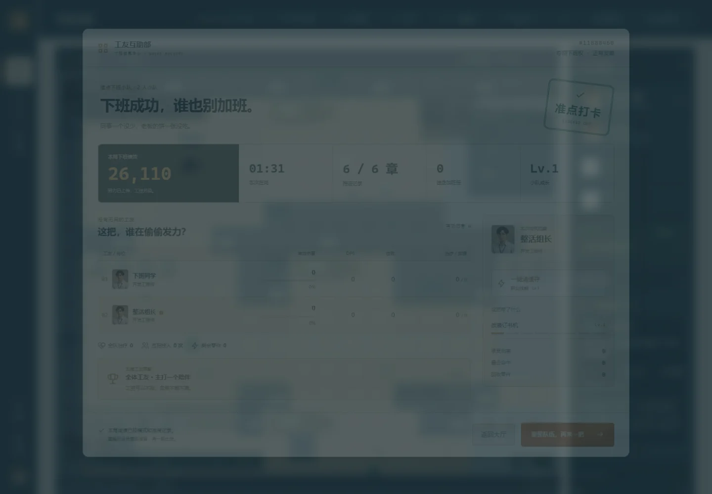
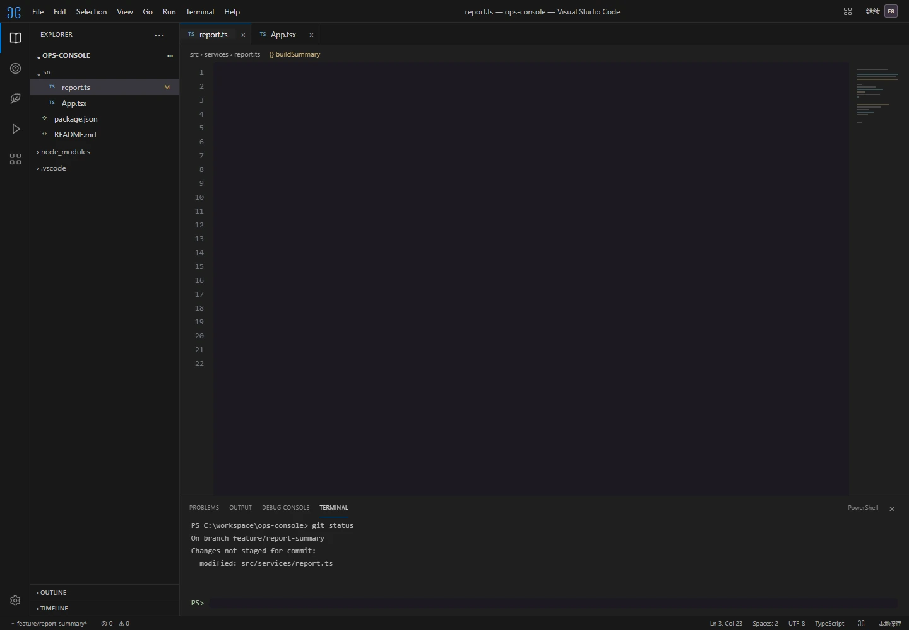

<div align="center">

# Off Duty Squad · 工位发癫局

**Attendance: perfect. Sanity: pending.**

A 1–4 player online co-op survival game that turns workplace absurdity into a roguelite battlefield. Pick a profession, assemble a build, and survive office zombies, outrageous KPIs, and your next performance review.

[简体中文](README.md) · [Docker deployment](docs/DEPLOYMENT.en.md) · [Releasing](docs/RELEASING.en.md) · [Controls](docs/CONTROLS.md) · [Changelog](CHANGELOG.md)

[](https://github.com/1045857717/off-duty-squad/actions/workflows/ci.yml)
[](https://github.com/1045857717/off-duty-squad/releases)
[](https://github.com/1045857717/off-duty-squad/actions/workflows/verify-release.yml)
[](https://github.com/1045857717/off-duty-squad/stargazers)
[](LICENSE)




</div>

## Features

- **Two co-op modes:** six mission-based expedition chapters with objectives and extraction, or an endless procedural campus with escalating waves and a boss every five waves.
- **28 workplace professions:** recognizable office roles and deliberately absurd careers, each with a permanent signature skill. Choose your first attack module inside the map; combat starts after everyone has chosen.
- **Builds that grow:** 16 attack modules, prerequisite-aware upgrades, and level 4 / level 8 evolutions. Upgrade offers follow your available growth branches.
- **Public chat:** cross-room conversations for lobby users, squads, players and spectators, with separate public/squad channels, unread indicators, preserved drafts and return to controls after sending.
- **Actual multiplayer:** host-controlled departure, player readiness, a cancellable three-second countdown, mid-run joining, 0–3 AI teammates, spectators, chat, rescue calls and revives.
- **Readable combat:** high-contrast numeric health/shields, recent-damage trails, direction-specific painted arms and continuous held weapons; enemy wind-ups and articulated attacks, persistent area effects, critical-hit and shield feedback, damage sources, a global boss bar and live damage rankings.
- **Codex and leaderboards:** enemies, professions and skills; daily, weekly, monthly, yearly and all-time squad rankings, separated by mode and difficulty.
- **Browser and optional Windows client:** independent browser windows; a portable Electron client adds frameless transparency, always-on-top, hiding and global restore.
- **Nine work-style views:** tasks, board, documents, spreadsheet, Excel-style sheet, mail, VS Code-style editor, IDEA-style editor and metrics. Editors are local interactive simulations.

| Expedition                                            | Endless survival                                             |
| ----------------------------------------------------- | ------------------------------------------------------------ |
| Six chapters, objectives, interactions and extraction | Procedural large map, random disasters, rising wave pressure |
| Chapter progression and a defined finish              | Continuous builds and survival records                       |



## Quick start

### Run locally

Install Node.js **24 LTS** (minimum 22.12) and npm.

```bash
git clone https://github.com/1045857717/off-duty-squad.git
cd off-duty-squad
npm ci
npm run build
npm start
```

Open [http://localhost:3000](http://localhost:3000). For development, run `npm run dev` and use the Vite URL printed in your terminal. Download the Windows portable client from [Releases](https://github.com/1045857717/off-duty-squad/releases), extract all files and enter the same server origin used by your browser.

### Deploy with Docker

The server needs Docker Engine and Compose v2. Put [compose.prod.yaml](compose.prod.yaml) and [.env.example](.env.example) in a permanent deployment directory, then copy the environment example to `.env`.

```bash
cp .env.example .env
# Edit GAME_VERSION, PUBLIC_URL and the host port.
docker compose -f compose.prod.yaml pull
docker compose -f compose.prod.yaml up -d --wait
curl -fsS http://127.0.0.1:3000/api/health
```

Released image: `ghcr.io/1045857717/off-duty-squad:<version>`, for Linux amd64 and arm64. Images become available after a successful release workflow. Repository and package visibility are separate settings. Use an HTTPS reverse proxy that preserves WebSocket upgrades for public access.

To update, back up the score data, set `GAME_VERSION` to a new release and repeat `pull` and `up -d --wait`. To roll back, restore the previous version setting and repeat. **Updating ends in-memory matches; scores remain in the named volume.** Do not run `down -v`. See the [deployment guide](docs/DEPLOYMENT.en.md) for backup and recovery.

## Controls

| Key                 | Action                                 | Key              | Action                           |
| ------------------- | -------------------------------------- | ---------------- | -------------------------------- |
| WASD / arrows       | Move                                   | Mouse            | Aim                              |
| Space / right mouse | Dash; optional Shift setting           | Q                | Profession signature             |
| E                   | Hold to interact / revive              | T                | Toggle auto attack               |
| 1 / 2 / 3           | Select upgrade                         | H                | Call for help while downed       |
| Enter               | Chat; return to controls after sending | U                | Show upgrade choices             |
| F2                  | Settings                               | F7               | Damage board                     |
| F8                  | Work view                              | F9               | Compact window                   |
| F10                 | Hide / restore                         | Ctrl + Shift + B | Global restore in desktop client |

See [all controls and platform limits](docs/CONTROLS.md). Browser opacity changes page content; showing the desktop through the window and hiding the native window require the optional desktop client.

## Development

```bash
npm run check         # Core tests, TypeScript and production build
npm run format:check  # Formatting
npm run browser:install
# Start the service before running browser scenarios:
npm run test:feedback
```

Built with **React 19, TypeScript, Phaser 3 / WebGL, Express and Socket.IO**. An authoritative Node server runs the simulation; clients interpolate snapshots for rendering. One service serves the website, HTTP API and WebSocket connections. Electron provides the optional Windows shell.

| Directory            | Responsibility                                         |
| -------------------- | ------------------------------------------------------ |
| `src/`               | Lobby, HUD, Phaser scene and rendering                 |
| `server/`            | Rooms, authoritative simulation, networking and scores |
| `shared/`            | Types, professions, growth branches and balance data   |
| `public/art/`        | Runtime artwork and generated sources                  |
| `electron/`          | Desktop shell and portable client                      |
| `tests/`             | Simulation, network, render and browser regressions    |
| `.github/workflows/` | CI, desktop artifacts and image publishing             |



<details>
<summary>View results and work-style interface</summary>

**3.5 health and shield acceptance scene**







</details>

## Status and limitations

Current version: **3.6.0**. This release adds persistent public/squad chat channels, unread indicators and new workplace satire. See [3.6 notes](docs/RELEASE-3.6.md). Combat retains the verified 3.5 animation pipeline; workflow badges reflect actual CI and publication status.

- The room server is a single-instance service. Replicas do not share rooms or presence; scaling requires room routing and shared storage design.
- A 144 FPS target setting is available. Measured dense scenes reached approximately 79 FPS; **144 FPS is not guaranteed**. See [performance notes](docs/PERFORMANCE-3.4.md).
- Browser window support varies. The Windows portable client is unsigned; no macOS or Linux desktop package is currently provided.
- Existing networking checks use multiple local clients and simulated latency. Cross-machine public-network soak testing remains outstanding.
- Ranking periods use Asia/Shanghai time and retain the most recent 50,000 results. Chat and live rooms are not persisted.
- The game UI is currently Simplified Chinese. This repository's documentation is bilingual.

## Contributing and support

Please read [CONTRIBUTING](CONTRIBUTING.md) before opening an issue or pull request. Report vulnerabilities through the [security policy](SECURITY.md).

Sponsor placements appear in the lobby rather than combat. Advertising contact: **QQ 1045857717**. The default AI gateway sponsor link is [api.xiebc.cc](https://api.xiebc.cc).

Released under the [MIT License](LICENSE). Third-party dependencies retain their own licenses; see [third-party notices](THIRD_PARTY_NOTICES.md). Project artwork provenance is documented in [ART-3.4](docs/ART-3.4.md).

## Star History

[](https://www.star-history.com/#1045857717/off-duty-squad&Date)

This chart is provided by the external Star History service using public repository data. It is not a built-in GitHub chart and may be unavailable while a new repository has no data.
