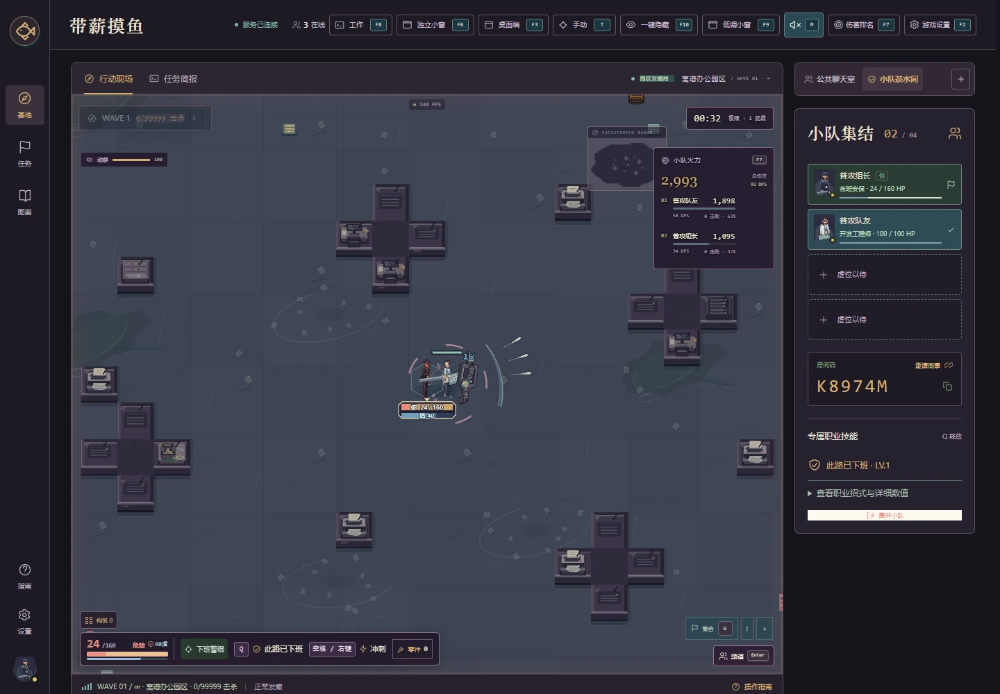
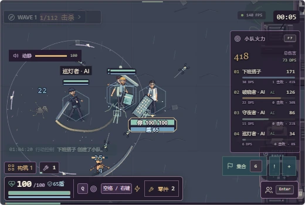

<div align="center">

# 带薪摸鱼 · Paid Break Crew

**班是公司的，鱼是自己的。**

一款由 AI 从零实现、把职场日常变成抽象战场的 1–4 人在线合作生存游戏。组队、随机成长、挑战办公室异变物与离谱 KPI，在下班前打出自己的构筑。

**[🎮 在线试玩 · moyu.xiebc.com](https://moyu.xiebc.com)**

无需下载，在浏览器中打开即可组队。桌面客户端请连接同一在线地址。

[English](README.en.md) · [Docker 部署](docs/DEPLOYMENT.md) · [版本发布](docs/RELEASING.md) · [操作指南](docs/CONTROLS.md) · [更新日志](CHANGELOG.md)

[](https://github.com/1045857717/off-duty-squad/actions/workflows/ci.yml)
[](https://github.com/1045857717/off-duty-squad/releases)
[](https://github.com/1045857717/off-duty-squad/actions/workflows/verify-release.yml)
[](https://github.com/1045857717/off-duty-squad/stargazers)
[](LICENSE)


</div>

## 从零开始，由 AI 开发

本游戏从最初原型到当前版本，代码、玩法实现、UI、程序动画、联机、测试、文档与打包发布工作，均由 AI 编程代理在作者持续提出需求、试玩和反馈的过程中完成。作者负责产品方向、体验验收与发布授权，并提供可选咖啡赞助收款码。实现建立在已有开源引擎与库之上。

[AI 开发全过程](docs/AI-DEVELOPMENT.md) · [真实需求与提示词演进](docs/PROMPT-HISTORY.md) · [请作者喝咖啡](docs/SUPPORT.md)

## 游戏特色

- **两种合作玩法**：六章目标式行动“夺回下班权”，以及程序化大地图、持续加压的“园区发癫局”无尽生存。
- **28 个职场职业**：IT、行政、创意与抽象职业各有固有普攻与固定 Q；进入地图后共同选好首个随机模块，再开始对局。
- **可成长的随机构筑**：16 种攻击模块、条件匹配的成长分支、Lv.4 / Lv.8 进化；抽到的是当前能用的成长方向。
- **公共聊天室**：大厅、组队、对局与观战可跨房间聊天；公共/小队频道分开，未读提示与草稿保留，发送后回到操作。
- **真实联机小队**：房主发起、队员准备、3 秒倒计时；支持中途加入、0–3 名 AI、观战、聊天、倒地呼救与协作救援。
- **清楚的战斗反馈**：七类办公室异变敌人与下颌、肘、腕、膝、踝动作；高对比数字生命/护盾、损血拖尾、统一六视角分件人物、职业工具与连续攻击动作；敌人蓄力与攻击动作、持续范围特效、暴击与护盾反馈、伤害来源、全局 BOSS 血条和实时伤害榜。
- **图鉴与周期排名**：职业、敌人和技能图鉴；按模式、难度划分的日 / 周 / 月 / 年 / 总榜。
- **网页与 Windows 小窗**：F9 低调视图、F6 浏览器独立小窗；可选 Windows 便携客户端提供无边框、透明度、置顶、隐藏与全局恢复。
- **九种工作界面**：任务、看板、文档、表格、Excel、邮件、VS Code 风格、IDEA 风格与数据面板。IDE 界面是本地交互模拟。

| 目标式行动                           | 无尽生存                              |
| ------------------------------------ | ------------------------------------- |
| 六章任务、收集与交互、完成目标后撤离 | 大地图随机灾变、递增怪潮、每五波 BOSS |
| 明确的章节进度与终点                 | 持续构筑与生存纪录                    |


实机截图：1位玩家与3位实际服务端AI，未注入假血量；[整备界面](docs/images/ready-41.webp) · [八方向挥击](docs/images/directions-40.webp) · [敌人动作](docs/images/enemies-40.webp)。

## 快速开始

### 本地运行

需要 Node.js **24 LTS**（最低 22.12）和 npm。

```bash
git clone https://github.com/1045857717/off-duty-squad.git
cd off-duty-squad
npm ci
npm run build
npm start
```

打开 [http://localhost:3000](http://localhost:3000)。开发时使用 `npm run dev`，以前端终端输出的 Vite 地址为准。Windows 便携客户端从 [Releases](https://github.com/1045857717/off-duty-squad/releases) 下载，解压后输入与你的网页相同的服务器地址。

### Docker 部署

服务器只需 Docker Engine 和 Compose v2。下载仓库中的 [compose.prod.yaml](compose.prod.yaml) 与 [.env.example](.env.example)，放在同一固定目录，将后者复制为 `.env`。

```bash
cp .env.example .env
# 编辑 .env：设置 GAME_VERSION、PUBLIC_URL 和端口
docker compose -f compose.prod.yaml pull
docker compose -f compose.prod.yaml up -d --wait
curl -fsS http://127.0.0.1:3000/api/health
```

正式发布镜像：`ghcr.io/1045857717/off-duty-squad:<版本号>`，支持 Linux amd64 / arm64。镜像仅在版本发布工作流成功后可用；仓库公开与镜像公开需分别确认。公网推荐 HTTPS 反向代理，并保留 WebSocket Upgrade。

更新时先备份排行榜数据，在 `.env` 中修改 `GAME_VERSION`，再次运行 `pull` 和 `up -d --wait`。回退时改回上一版本执行相同步骤。**对局存在内存中，更新会结束当前对局；排行榜保存在数据卷中。** 请勿执行 `down -v`。完整说明见 [部署文档](docs/DEPLOYMENT.md)。

## 操作

| 按键          | 功能                     | 按键             | 功能            |
| ------------- | ------------------------ | ---------------- | --------------- |
| WASD / 方向键 | 移动                     | 鼠标             | 瞄准 / 左键攻击 |
| 空格 / 右键   | 冲刺，设置中可启用 Shift | Q                | 职业专属技能    |
| E             | 持续交互 / 救援          | T                | 自动攻击开关    |
| 1 / 2 / 3     | 选择成长选项             | H                | 倒地呼救        |
| Enter         | 聊天，发送后返回操作     | U                | 展开成长选项    |
| F2            | 设置                     | F7               | 伤害榜          |
| F8            | 工作界面                 | F9               | 小窗            |
| F10           | 隐藏 / 恢复              | Ctrl + Shift + B | 桌面端全局恢复  |

完整快捷键与浏览器能力边界见 [操作指南](docs/CONTROLS.md)。普通网页透明度只能改变内容显示，无法让桌面透过浏览器或隐藏整个浏览器进程；这些功能由桌面端提供。

## 开发与验证

```bash
npm run check         # 核心测试 + TypeScript + 生产构建
npm run format:check  # 代码格式
npm run browser:install
# 启动服务后按需运行：
npm run test:feedback
```

技术栈：**React 19 + TypeScript + Phaser 3 / WebGL + Express + Socket.IO**。Node 服务器负责权威模拟，客户端插值渲染；同一服务提供页面、HTTP API 与 WebSocket。Windows 客户端基于 Electron。

| 目录                 | 用途                               |
| -------------------- | ---------------------------------- |
| `src/`               | 大厅、HUD、Phaser 场景与客户端渲染 |
| `server/`            | 房间、权威模拟、联机协议与排行榜   |
| `shared/`            | 类型、职业、成长树与数值定义       |
| `public/art/`        | 运行时美术资源与生成来源           |
| `electron/`          | Windows 小窗与便携客户端           |
| `tests/`             | 模拟、网络、渲染与浏览器回归       |
| `.github/workflows/` | 持续集成、桌面端与镜像发布         |


<details>
<summary>查看结算统计与工作界面</summary>

**4.0生命、护盾与构筑验收场景**



**F9低调视图（520×350，仍在同一房间）**




</details>

## 当前状态与边界

版本 **4.1.2**。游戏内增加 FPS / RTT 状态；补齐屏幕外实体剔除，加入有上限的远端插值缓冲和密集战斗 20Hz 广播预算，战斗模拟仍保持 60Hz。详见[本轮性能优化与复测](docs/PERFORMANCE-4.1.2.md)。此前 增加 WebSocket 压缩与视觉坐标传输精度优化，减少后期同步流量；聊天消息区与职业技能说明重新排版，GitHub 入口保留清楚文字，提供四独立浏览器的高刷诊断工具。详见[同步性能与测试边界](docs/PERFORMANCE-4.1.1.md)和[大厅可读性](docs/LOBBY-4.1.1.md)。大厅改为上方选择玩法、下方工友集合的游戏整备界面；无尽首波重新校准为可清怪的开局，敌人组合与精英逐波加入。E交互明确显示真实收益、费用和持续效果，修复F8各工作视图背景串色。详见[4.1玩法与修复](docs/PLAYABILITY-4.1.md)和[开局伤害审计](docs/balance-4.1.json)。4.0的[美术动作](docs/ART-4.0.md)、[逐职业矩阵](docs/COMBAT-4.0.md)、[已发布验收](docs/PUBLISHED-4.0.md)与[分支保护策略](docs/BRANCH-PROTECTION.md)继续保留。

- 目前采用单实例房间服务，多个副本不会共享房间或在线人数。正式扩容前需要独立的房间路由与共享存储设计。
- 支持144FPS目标档位，实际取决于硬件、分辨率和敌人密度，**不保证全场景144FPS**。上一轮4.0测量和限制见[4.0性能实测](docs/PERFORMANCE-4.0.md)，旧版本结果保留在历史报告。
- 浏览器小窗依赖浏览器能力；Windows 便携包尚未代码签名，目前不提供 macOS / Linux 桌面包。
- 现有网络回归在本机多客户端及人工延迟条件下完成，尚未覆盖公网跨机器长时间压力测试。
- 排行榜按北京时间统计，记录最近 50,000 场成绩；聊天与实时房间不会持久保存。

## 参与与支持

欢迎提交问题与改进建议。请先阅读 [贡献指南](CONTRIBUTING.md)；漏洞请遵循 [安全报告流程](SECURITY.md)。

大厅提供 AI 中转站入口及赞助展示位，不插入战斗画面。广告位联系 **QQ：1045857717**；默认赞助链接为 [api.xiebc.cc](https://api.xiebc.cc)。

<details>
<summary>请作者喝咖啡 · 微信扫码</summary>

自愿支持，不影响任何游戏内容。下图为作者提供的原始收款码，点击可查看原尺寸。

<a href="docs/support/wechat-coffee.png"></a>

[赞助说明](docs/SUPPORT.md)

</details>

本项目采用 [MIT 许可证](LICENSE)。第三方依赖保留各自许可，见 [第三方声明](THIRD_PARTY_NOTICES.md)；当前项目美术来源见 [ART-4.0](docs/ART-4.0.md)，历史素材见 [ART-3.4](docs/ART-3.4.md)。

## Star History

[](https://www.star-history.com/#1045857717/off-duty-squad&Date)

图表由 Star History 第三方服务提供，读取公开仓库的 Star 数据。它不是 GitHub 内置图表，新仓库暂无数据时可能暂不显示。
