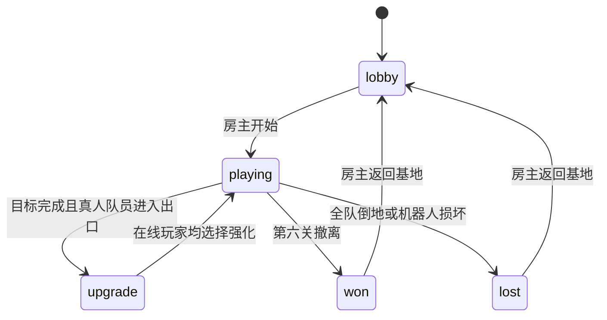

> 当前4.0请看 [RELEASE-4.0.md](RELEASE-4.0.md)、[ART-4.0.md](ART-4.0.md)、[PERFORMANCE-4.0.md](PERFORMANCE-4.0.md) 与 [validation-4.0.json](validation-4.0.json)。以下为历史记录。

> 当前3.4请看 [RELEASE-3.4.md](RELEASE-3.4.md)、[PERFORMANCE-3.4.md](PERFORMANCE-3.4.md)、[DESIGN-3.4.md](DESIGN-3.4.md)。以下为历史记录。

> 当前3.3请看 [RELEASE-3.3.md](RELEASE-3.3.md)、[PERFORMANCE-3.3.md](PERFORMANCE-3.3.md)、[DESIGN-3.3.md](DESIGN-3.3.md)。以下为历史记录。

> 当前3.2请查看 [RELEASE-3.2.md](RELEASE-3.2.md)、[DESIGN-3.2.md](DESIGN-3.2.md)、[PERFORMANCE-3.2.md](PERFORMANCE-3.2.md)。以下为历史记录。

# 设计与架构

## 目标与节奏

为同事一起短暂休息设计的 1–4 人俯视角合作游戏。单关约 1–3 分钟取决于队伍熟练程度，六关构成连续行动；玩家不需要注册即可加入。重点是低操作门槛、可理解的共同目标与职业互助。

默认自动瞄准，保留移动、技能、冲刺与交互。合作发生在终端分工、护送机器人、保护补给员、救起队友与传送门集合。四个职业都能独立完成目标，避免必须拥有某职业才能通关。

## 美术与界面

夜间植物研究站：深松绿背景、暖米白正文、浅叶绿主操作、琥珀提示与少量职业色。植物、木制设备、终端、机器人与敌人均为可编辑 Canvas 像素绘制，由 Phaser 注册为本地纹理，无运行时远程资产依赖。

大厅直接显示实际游戏场景与角色动画。左导航控制基地、任务和档案；中间是实时游戏画面与关卡路线；右侧是小队与职业设置。实战 HUD 只显示生命、技能、目标和计时，窗口缩小时仍保留核心信息。

三区复用可熟悉的地图通路，切换设备和配色。后两关增加有两秒预警的孢子区。所有终端和晶体都在可到达区域内，机器人采用明确的走廊路线。AI 和敌人通过网格 BFS 与直线可达性检测选择路径。

## 技术分工

- React 19、TypeScript、Vite 6：可访问 DOM 界面、对话框焦点管理、设置和本地档案。
- Phaser 3.90：游戏循环、键鼠输入、纹理、精灵动画、摄像机、粒子式反馈。
- Express、Socket.IO：同源 HTTP 与 WebSocket、房间、会话和广播。
- Node 权威模拟：目标约 30 Hz，向客户端广播约 15 Hz；客户端插值精灵。输入限制幅度、方向归一化、拒绝非有限数值，300ms 无输入自动停止。
- Electron：Windows 无边框透明窗口，关闭 Node 集成、启用上下文隔离和 sandbox，通过窄 preload 接口请求透明度、窗口尺寸、置顶、穿透和关闭。

权威状态不由客户端上传。客户端只能请求创建/加入、选择职业、开始、输入和强化；服务器检查房主、阶段、容量和升级有效性。房间码由密码学随机源生成，会话使用随机 UUID token。会话存 sessionStorage，偏好与档案存 localStorage。

## 状态机

第一关即可体验采集、战斗与撤离。六关经过三种常规任务再进入首领战。强化只在关间选择，每次三选一，避免战斗中频繁打开复杂菜单。

## 窗口与输入

浏览器只保证页面内部的透明渲染，不声称能透出操作系统桌面；Electron 通过透明窗口与 setOpacity 实现桌面叠加。小窗使用固定尺寸以减少透明窗口兼容问题。OS 全局快捷键可在鼠标穿透或隐藏窗口时恢复操作。

F8 的工作面板是纯本地视图；切换时停止本人输入，服务器继续推进。后台标签页也会停止输入，全队断线时暂停模拟；不把浏览器失焦当作联机暂停。

技能与冲刺使用按键锁存，避免轻按发生在两次 45ms 输入发送之间时丢失。界面禁用游戏输入时，不接受新的技能锁存。

## 验证与扩展

核心测试覆盖房主权限、四人限制、输入健壮性、碰撞、射击归属、治疗、救援、掉线静止、目标共享、职业效率、完整六关状态流转、机器人无碰撞路线和孢子预警。网络测试使用真实 Socket.IO 客户端。浏览器测试使用独立浏览器上下文验证实际界面和同步。

房间为单进程内存状态，适合少量队伍的单服务部署。后续如需要账号、长期战绩、跨实例房间或匹配，应在会话与房间管理边界接入持久化及广播适配器；不要让客户端持有权威结算。

## 1.1 独立窗口与性能

浏览器采用 Document PiP 容器内的同源游戏 iframe，使游戏循环在可见的小窗上下文中运行；不支持时使用普通 popup。主页面保留会话 token 与管理界面，委托期间不重连抢占角色，并卸载 Phaser。关闭或收回小窗时用同一个 token 恢复身份，隐藏操作会关闭子窗口但保留主页面恢复入口。敏感 token 不放进 URL；普通弹窗仅向同源且来源匹配的窗口发送会话信息。

网络 hook 保存一个实时快照 ref，Phaser 直接读取；React 界面约每 120ms 更新一次，重要阶段变化立即发布。渲染循环显式设置 Phaser 的 fps.limit，保留原生 requestAnimationFrame。角色名颜色只在变更时更新，避免 Canvas 文字重新生成与 GPU 上传。短时间运动预测限制为 100ms，并复用地图碰撞。隐藏时休眠游戏循环和清空输入，展示时唤醒。

Electron 增加托盘与共享的显示/隐藏处理函数，全局快捷键和托盘采用同一条恢复路径。后台节流关闭以保证可见但未聚焦的浮窗正常绘制；真正隐藏时由游戏主动休眠，避免无意义的后台渲染。

## 1.2 高清与高刷新率

不再默认限制60帧。Phaser使用原生requestAnimationFrame、关闭像素取整，按DPI放大实际画布再以CSS缩回逻辑大小。默认解锁刷新率；可选帧上限使用保留余数的FramePacer，避免144上限在240Hz屏幕降为120。没有用setInterval伪造帧率。

场景与角色均为2x代码原生画布资源。角色单张图集每方向24帧共8方向，以实际移动距离推进步态；GPU精灵图集采样，不在每帧重画角色。武器独立旋转；射击冷却边沿触发后坐力/枪口光，技能冷却边沿触发施法光圈，冲刺生成短寿命残影。敌人8帧图集、晶体浮动、终端充能、机器人悬浮和传送门旋转均使用时间驱动。静态环境、光晕、装备与终端缓存为纹理。伤害数字复用24个文字对象，按命中事件生成，避免每帧重新排版。

原先effect构造从实体展开时会覆盖唯一id，导致同一敌人后续命中不再产生新视觉事件；现在只复制坐标，id全局唯一，并有重复命中回归测试。

服务器tick约60Hz、广播约30Hz。客户端本人输入本帧预测，持续与服务器纠偏；冲刺先做相同地图碰撞预测，短时间等待权威状态。敌人/其他玩家有限外推，弹丸按快照年龄补间。技能与冲刺边沿在服务器排队，移动包被限流时也不丢失技能事件；死亡、断线、过关清理队列。

伤害通过统一dealDamage入口扣除敌人实际剩余生命，并累计至造成伤害的玩家。工程师范围技能逐目标计入；不计溢出或重复死亡。rankDamage按伤害、击败数和身份稳定排序。UI展示共享状态中的总伤害、占比、DPS、击败数和治疗量，没有客户端自报排名。历史/偏好跨同源窗口同步，结算去重保存在localStorage防止浮窗返回后重复计分。

桌面窗口使用frame:false、thickFrame:false、roundedCorners:false、无菜单；沉浸模式收起自定义工具栏，顶部悬停展开，F4常驻。浏览器系统边框明确告知不可由网页隐藏。

## 2.0 协议与系统边界

静态World（种子/格子/碰撞/连通房间）按地图更换可靠广播一次，动态GameState约30Hz可丢包广播。客户端保留当前世界，合并后续动态快照；新加入或重连直接收到完整世界。观战属于单独Session，不占Player容量，不允许输入/升级/开始游戏。所有观战者与队员共用房间聊天，服务端限制长度与频率，React以纯文本渲染。

生成器使用栅格房间+三格宽连通走廊，逻辑碰撞以格子查询；护送路线通过BFS构造，敌群使用共享寻路场降低逐敌寻路开销。美术以512逻辑像素分块，各块2倍像素，摄像机围绕本地角色或观战目标移动。

角色身份保留基础职业；随机主动技能用Ability字段与单调动作序号同步。冲刺是带速度与剩余时间的持续状态，而不是瞬移。客户端预测同样持续位移，并沿移动路径生成残影。敌人蓄力、攻击序号和扑击速度属于权威状态；渲染据此播放蓄力/伸缩/挥击，不从画面反推伤害。

ScoreStore只接服务器结束状态，按模式和难度过滤，写临时文件后rename原子替换。运行榜单不持久化每一帧；只保存有效结算。默认单进程、单写入者；多个实例共享JSON文件是不支持的部署方式。

工作台仅为本地可编辑示例数据：列表/看板共用任务模型，文档和表格各自本地持久化。切换工作不暂停网络战斗。推广位仅在大厅/房间浏览/榜单出现，游戏进行时不显示广告。

## 2.1 非阻塞战斗界面

升级UI与战斗输入解耦：数字键和点击调用同一服务器offer验证入口，界面仅覆盖卡片自身，不建立全屏遮罩。章节休整也复用编号卡条但其权威阶段不模拟战斗。按键在工作台、聊天输入、可编辑元素与设置内不触发战斗快捷选择。

runId负责完整回合生命周期，React和Phaser各自的暂存状态在新run清理；模式卡直接同步已有房间服务端配置，避免只变页面不变实际房间。

效果协议增加ability、angle、enemyKind和warning，客户端不再用一圈相同光效表示全部技能。CombatFX复用固定粒子池，按事件生成而非每帧新建。仅bomber+warning=true允许绘制敌方地面范围；其他怪物保留本体动作和攻击结果。

游戏画面透明度只作用于game-stage，包含canvas/战斗HUD/消息，不影响设置可读性；OS原生窗口setOpacity独立设置。透明消息流不接收鼠标，按本地时间显示最近消息，普通聊天输入框另开。
