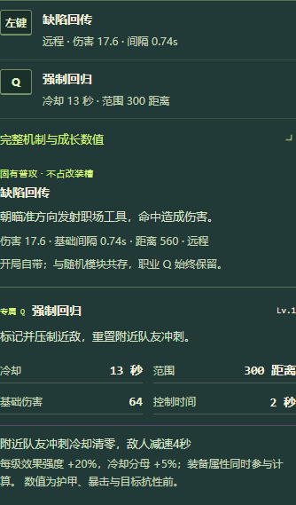

# 4.1.1 大厅可读性 / Lobby readability

本次保留带薪摸鱼大厅的深绿、纸白与酸橙色视觉体系，调整实际使用中的信息层级。

- 原技能说明框约74px高，内容约386px。现在默认展示普通攻击与Q及关键数值；完整机制通过原生展开控件进入正常文档流，不再塞入微型滚动框。更换职业明确展示28个岗位，选择后收起。
- 聊天消息区由95px增加到至少220px；1366px桌面侧栏360px。昵称、观战标记与时间在元信息行，正文独占整行并可断行长链接。输入法、未读、草稿、旧消息滚动位置和发送后回归操作都保留。
- 大厅窄屏默认可见聊天，对局仍默认折叠。GitHub保留文字标识，触达高度44px。
- 1366×768准备大厅的四个席位、聊天和出发操作同屏可见。文字/图标与聊天样本对比度均超过4.5:1；390px手机无横向溢出。
- 已入房时，Enter在原生button、link和summary上执行自身动作；在对局画面仍能打开聊天。

English: The patch keeps the current game identity while restoring readable content hierarchy. Basic/Q summaries remain visible; full mechanics expand in page flow rather than a74px internal scrollbox. Public chat uses a metadata row and full-width body, a larger message area, draft/unread/follow preservation and ordinary IME handling. The labelled GitHub entry is44px high. Desktop readiness and departure remain in one viewport; narrow screens do not overflow. Native keyboard activation is preserved alongside game chat shortcuts.

Verification: `npm run test:lobby`, `npm run test:community`, `npm run test:careers` and `npm run test:comedy`. The careers download check uses a locally packaged real Windows client. High-refresh four-player diagnostics use `npm run test:multiplayer`; see the separate performance report for actual sample values and environment limits.
