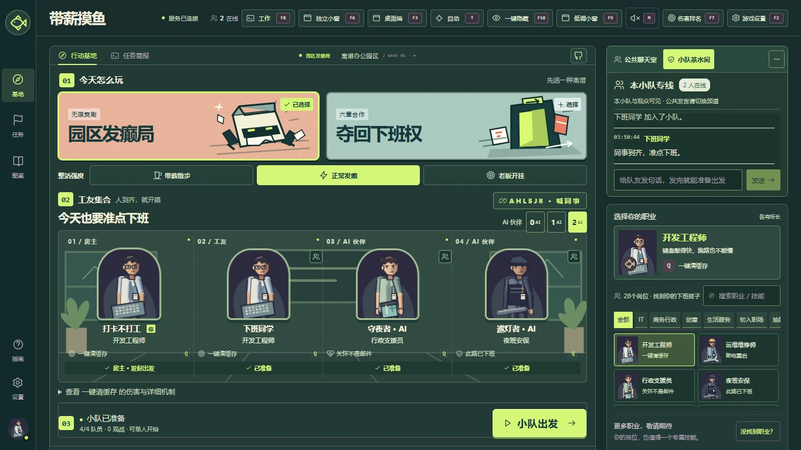
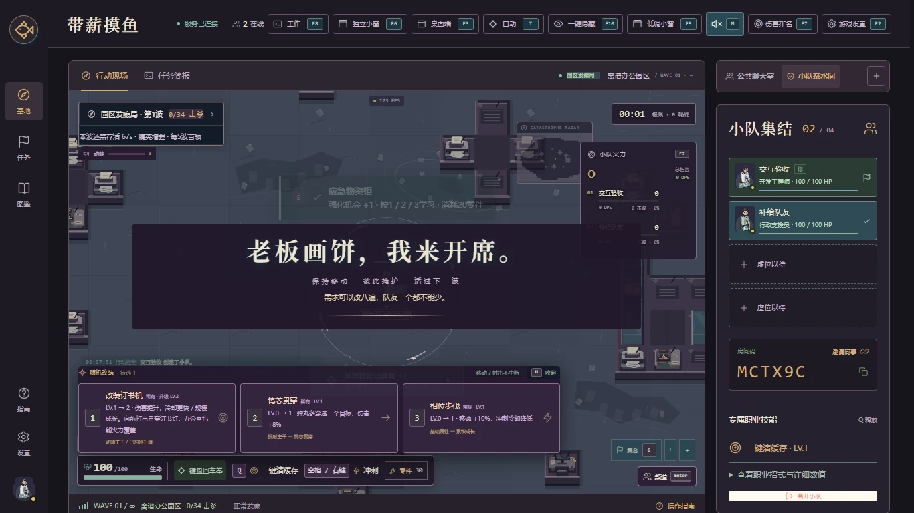
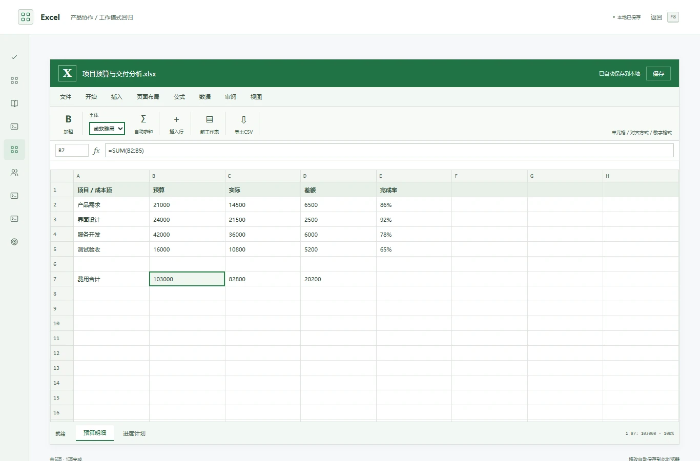

# 带薪摸鱼 4.1：开局、交互与大厅

## 设计目标

先选玩法，再组队。前几波能清怪、获得构筑方向；后续通过敌人组合、密度、精英和逐波强度带来挑战。交互必须能说清目标、代价和实际结果。工作模式保留各应用自己的界面颜色。

## 无尽压力曲线

首波仅纸魔与爬行追击怪，第2波加入远程，第3波加入自爆，第4波加入重型与低概率精英，第6波加入幽灵；每5波首领。基础怪生命系数从0.70起，随波次线性增长并在第4、10波后进一步增长。四人开局生命系数为单人1.54倍，刷怪频率为1.84倍，早期每批1只；后期人数耐久系数最高2.08倍，批量与基础生命仍继续增长。职业普攻、随机模块和Q保持独立。

旧版1.9倍基础生命、人数倍数、波次生命和人数刷怪叠加使首波出现超出开局输出的敌人。本次保留远征原有曲线，单独重新设计无尽。中途加入按当前波次与小队历史最大人数调整现存敌人，保留血量比例；离开不降低压力。血包与零件稀缺规则、16秒升级间隔保持。

## E 交互

前后端使用相同目标选择：优先救援与任务充能，其余按实际距离选择补给或机关。持续按住只完成一次交互，松开E后才会再次操作。成功信息显示具体收益，失败信息解释原因；反馈不抢走移动与战斗输入。

- 应急柜与补给箱：增加一次强化机会，清楚提示按1/2/3学习以及共享零件代价。
- 加班审批：同样保留强化待选，清楚说明生命代价与永久敌潮增幅。
- 医药点：逐人通知实际生命、护盾增量，可救援；周围队员均不需要补给时保留。
- 打印机：8秒引怪，不造成伤害；喷淋：170范围内减速50%，持续10秒。
- 档案柜、卷帘门：报告实际命中数量与伤害，未命中会说明。放置位置有队员时不生成障碍并说明原因。

## 验证

新增行为测试覆盖奖励到账、多人回执、满额补给、目标一致、机关实际用途、28职业首波普攻击杀，以及早期/后期与人数压力曲线。浏览器检查实际大厅与工作界面、联机消息和交互反馈。具体测试结果在发布验证记录中提供。

首波随机事件只从增益与福利事件中抽取；第2波加入环境事件，第3波后开放完整事件组合。

## 界面实拍

开局伤害审计涵盖28职业 × 单人/四人 × 两类普通敌人，共112例。在目标已处于普攻范围、目标静止、不使用随机模块/Q/暴击的固定环境中，最慢击杀为3.567秒；这不是实际追击与生存时长承诺。原始结果和每波曲线见[balance-4.1.json](balance-4.1.json)。

本地验收：142项核心测试、5项发布规则、12套浏览器回归通过；保留首轮发现及修复记录，见[validation-4.1.json](validation-4.1.json)。
