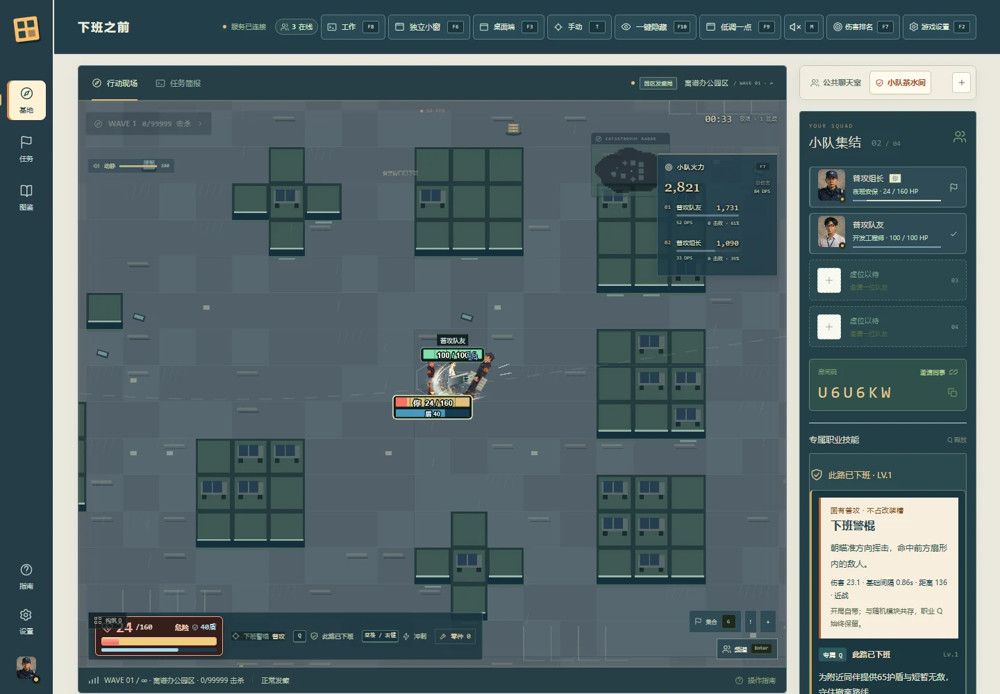

# 3.7.0 — 月薪三千，火力三亿

日期：2026-10-22，Asia/Shanghai。

## 战斗与血条

- 28个职业拥有独立固有普攻：警棍、扳手、拖把、飞刀、咖啡等。普攻不占四个随机模块槽，不替换Q；进入地图后的首次随机选卡保留。
- 统一服务端出手与共享动画的接触阶段，普攻动作保持连续；随机模块保留独立冷却、伤害与效果。
- 增强真实14关节的手臂/躯干动作、射击后坐、工具大小、逐工具握持与尖端几何、有界连续轨迹。
- 本机生命条改为脚下高对比数字条，队友条保留头顶，降低重叠；护盾独立成行，保留损血拖尾、破盾与倒地救援状态。HUD同步提高生命/护盾层级。

## 大厅与项目

- 新标题“月薪三千，火力三亿。”，配“老板画饼，我来清屏。”。
- 大厅新增GitHub图标入口与可选咖啡面板。使用作者提供的原始微信收款码，UI仅裁切预览，文件未修改；赞助不影响玩法。
- 中英文README加入[AI开发过程](AI-DEVELOPMENT.md)/[English](AI-DEVELOPMENT.en.md)与[27阶段提示词演进](PROMPT-HISTORY.md)/[English](PROMPT-HISTORY.en.md)。真实需求摘录与整理版复用模板分开标记，说明作者和AI各自承担的工作。

## 验证 / Verification

本地通过 **113项核心测试 + 5项发行契约测试**，**47组真实浏览器功能回归**、页面错误0。覆盖28职业空构筑普攻、实际模型绘制层级、16模块、28职业Q、7类敌人、血条/护盾、公共聊天，以及每方向75ms延迟下的准备/重连/重开。

帧率记录：默认无头刷新约59.55FPS且渲染与RAF一致；显式解除浏览器刷新限制的实验配置约143.67FPS，DPR2。普通场景验收不保证所有密集场景144FPS，见[性能记录](PERFORMANCE-3.7.md)与[原始结果](validation-3.7.json)。

作者二维码原图与界面实际预览都能解码，原图SHA256保持一致。发行镜像与下载包将在发布后独立核对。

Innate basic attacks coexist with profession Q and random modules. This release aligns animation contact with server release, refines actual grips and readable vitals, and adds project/support links plus a bilingual AI development/prompt history.
